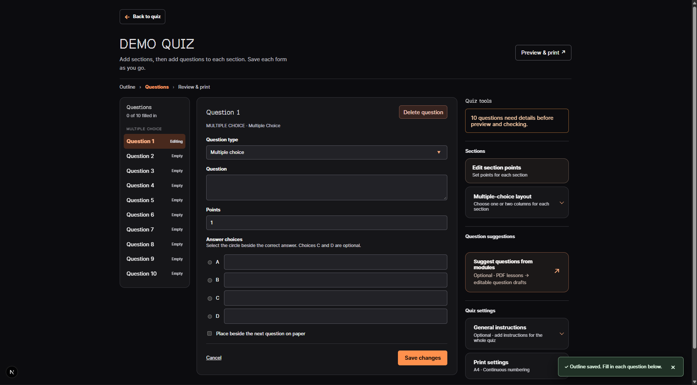
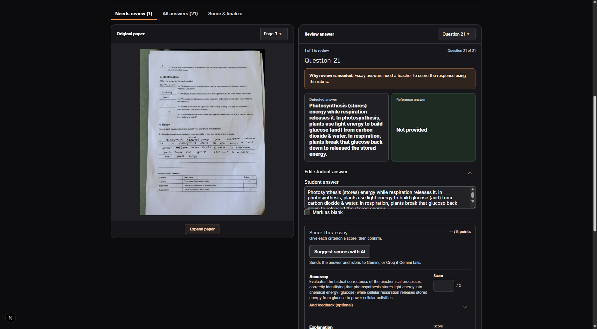
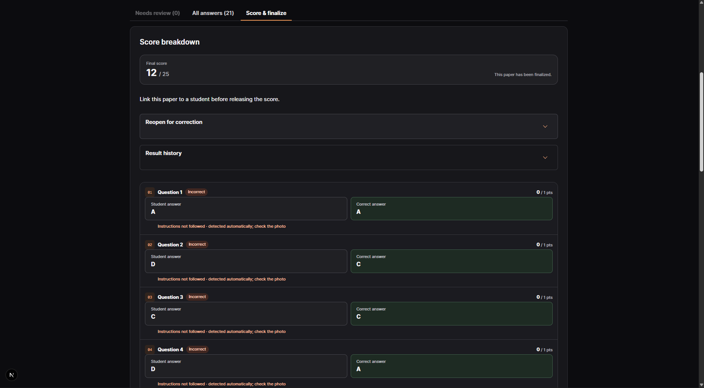

# CheckMate

**Create quizzes, check paper submissions, and share results in one place.**

CheckMate is a prototype web application for teachers who work with printed quizzes. Teachers can build quizzes or bring their own answer keys, upload photos of student papers, and review AI-assisted readings before finalizing scores. Students can view results released to their accounts.

## What you can do

- **Build and print quizzes** with multiple-choice, identification, true/false, and essay questions, answer keys, and rubrics.
- **Import existing quizzes or answer keys** from PDFs and photos, then review and correct the extracted content.
- **Check paper submissions** from photos, review detected answers and suggested scores, and finalize each result.
- **Manage student records and results**, export finalized scores as CSV, and share released results with students.
- **Get AI-assisted suggestions** for questions from text-based modules and for essay rubrics and feedback.

AI output can be inaccurate. Teachers remain responsible for checking readings, answers, and scores against the original work.

## How it works

1. **Prepare a quiz.** Create questions in CheckMate, import a quiz, or add an answer key for a quiz made elsewhere.
2. **Upload paper photos.** Add one to three photos per paper and check their order before starting a reading.
3. **Review the results.** Compare detected answers with the original paper, resolve flagged items, and score essays using a rubric.
4. **Finalize and share.** Save the score, link the paper to a student when needed, and release the result or export finalized scores.

Teachers can also revise correct answers and reopen finalized papers for correction. CheckMate records score revisions so changes can be reviewed later.

## See CheckMate in action

### Create a quiz

Organize questions into sections, set points and answers, and prepare a quiz for printing.



### Review a paper

Compare the original paper with detected answers and use a rubric to review essay responses.



### Review the score

See the score breakdown and question-by-question results after finalizing a paper.



## Getting started

### Requirements

- Node.js 22.12 or newer in the 22.x line (or a compatible version supported by Prisma)
- PostgreSQL
- Google OAuth credentials for Google sign-in, if desired
- A Groq and/or Gemini API key for AI-powered features

### Local setup

1. Clone the repository and install dependencies:

   ```bash
   git clone https://github.com/justinerei/CheckMate.git
   cd CheckMate
   npm ci
   ```

2. Create an empty PostgreSQL database and copy `.env.example` to `.env.local`:

   ```bash
   cp .env.example .env.local
   ```

   In PowerShell, use `Copy-Item .env.example .env.local` instead.

3. Set `DATABASE_URL` and `AUTH_SECRET` in `.env.local`. Add provider credentials for the sign-in and AI features you want to use. Generate a secret with:

   ```bash
   node -e "console.log(require('crypto').randomBytes(32).toString('base64'))"
   ```

4. Apply the database migrations and start the app:

   ```bash
   npx prisma migrate deploy
   npm run dev
   ```

5. Open [localhost:3000](http://localhost:3000). You can register with email and password, or configure Google OAuth to use Google sign-in.

See the [local setup and usage guide](docs/LOCAL_SETUP.md) for Google OAuth configuration, demo accounts, feature details, and troubleshooting.

### Environment variables

| Variable | Purpose |
| --- | --- |
| `DATABASE_URL` | PostgreSQL connection string |
| `AUTH_SECRET` | Secret used to secure authentication sessions |
| `AUTH_URL` | App origin; use `http://localhost:3000` locally |
| `GOOGLE_CLIENT_ID`, `GOOGLE_CLIENT_SECRET` | Google sign-in credentials, when using Google OAuth |
| `GROQ_API_KEY`, `GEMINI_API_KEY` | Credentials for the AI providers used by enabled features |
| `GROQ_VISION_MODEL`, `GEMINI_TEXT_MODEL` | Optional model overrides |

Keep credentials in your local environment file and never commit them. See `.env.example` and the [setup guide](docs/LOCAL_SETUP.md) for provider setup and feature requirements.

## Tech stack

- [Next.js](https://nextjs.org/) and [React](https://react.dev/)
- [TypeScript](https://www.typescriptlang.org/)
- [PostgreSQL](https://www.postgresql.org/) and [Prisma](https://www.prisma.io/)
- [Auth.js](https://authjs.dev/) for authentication
- Groq and Gemini for AI-assisted features

## Development commands

| Command | Purpose |
| --- | --- |
| `npm run dev` | Start the development server |
| `npm run lint` | Run ESLint |
| `npm test` | Run the automated test suite |
| `npm run build` | Create a production build |
| `npx prisma migrate status` | Check database migration status |

## Project status and data

CheckMate is a prototype. Use sample data while evaluating it, and review AI-assisted results before relying on them. Uploaded paper photos are stored in `.private/uploads/`, separately from PostgreSQL; back up both together. Files and extracted content sent to AI features are processed by the configured providers, so avoid uploading sensitive information without considering their data policies.

## Developers

Built by:

- **Justine Rei SA. Janolino** — [@justinerei](https://github.com/justinerei)
- **John Harold P. Beladas** — [@ryionaes](https://github.com/ryionaes)
- **Mark Kenneth V. Franciso** — [@0324-0537-png](https://github.com/0324-0537-png)

## License

Copyright © 2026 Justine Rei SA. Janolino, John Harold P. Beladas, and Mark Kenneth V. Franciso. All rights reserved. See [LICENSE](LICENSE) for details.
